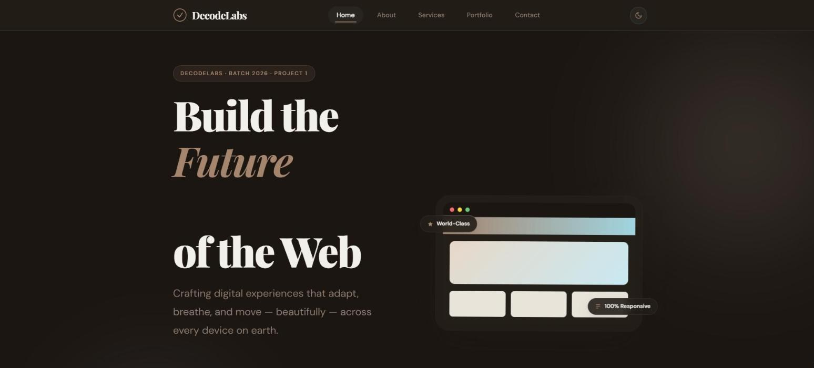

<div align="center">

# DecodeLabs Project 1: Responsive Frontend

**A mobile-first, accessible single-page site built with zero frameworks.**

[](https://connectabdullahdev.github.io/Decodelabs-1st-project/)




</div>

## About

Project 1 of my full stack internship at **DecodeLabs** (Batch 2026), the interface layer of a three-part series:

| Project | Layer | Repository |
| --- | --- | --- |
| 1 | Interface: responsive frontend | **this repo** |
| 2 | Engine: REST API with Node.js and Express | [Decodelabs-2nd-project](https://github.com/connectabdullahdev/Decodelabs-2nd-project) |
| 3 | Memory: MongoDB Atlas with Mongoose | [Decodelabs-3rd-project](https://github.com/connectabdullahdev/Decodelabs-3rd-project) |

## Features

- **Mobile-first layout** with breakpoints from under 360px up to 1536px and wider
- **Dark and light themes** that follow the system setting and remember your choice
- **Portfolio filter** by category
- **Contact form** with real-time, field-by-field validation
- **Scroll animations** driven by `IntersectionObserver`, with throttled and debounced handlers
- **Accessible markup:** semantic HTML5 landmarks and ARIA attributes throughout
- Print styles and touch-friendly hit areas

## How the CSS is organised

```
styles/
├── reset.css        # consistent baseline across browsers
├── variables.css    # colours, spacing and type scale as custom properties
├── layout.css       # page structure and grid
├── components.css   # buttons, cards, forms, navigation
├── animations.css   # keyframes and reveal effects
└── responsive.css   # breakpoints, dark mode, print
scripts/
└── app.js           # theme, filter, validation and scroll behaviour
```

## Run it locally

```bash
git clone https://github.com/connectabdullahdev/Decodelabs-1st-project.git
cd Decodelabs-1st-project
npx serve .        # or open index.html directly
```

---

<div align="center">

Built by **Muhammad Abdullah** · [LinkedIn](https://www.linkedin.com/in/connectabdullahdev) · [GitHub](https://github.com/connectabdullahdev)

</div>
